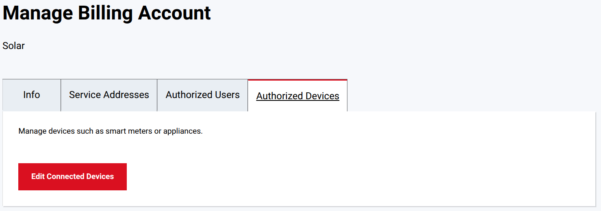
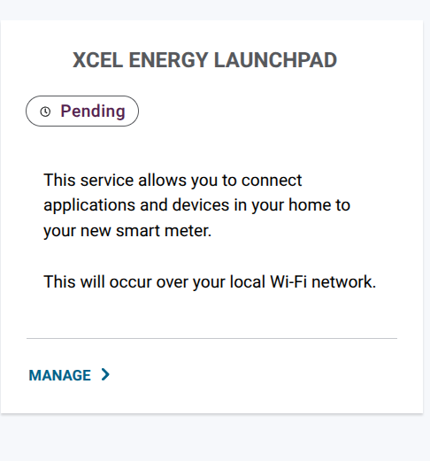
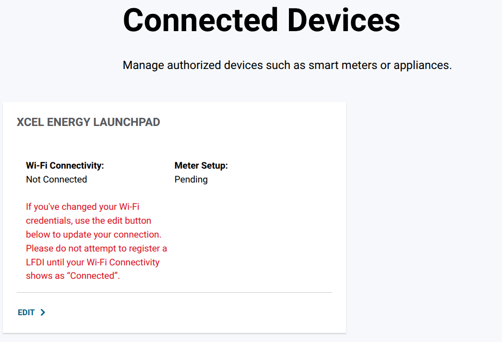
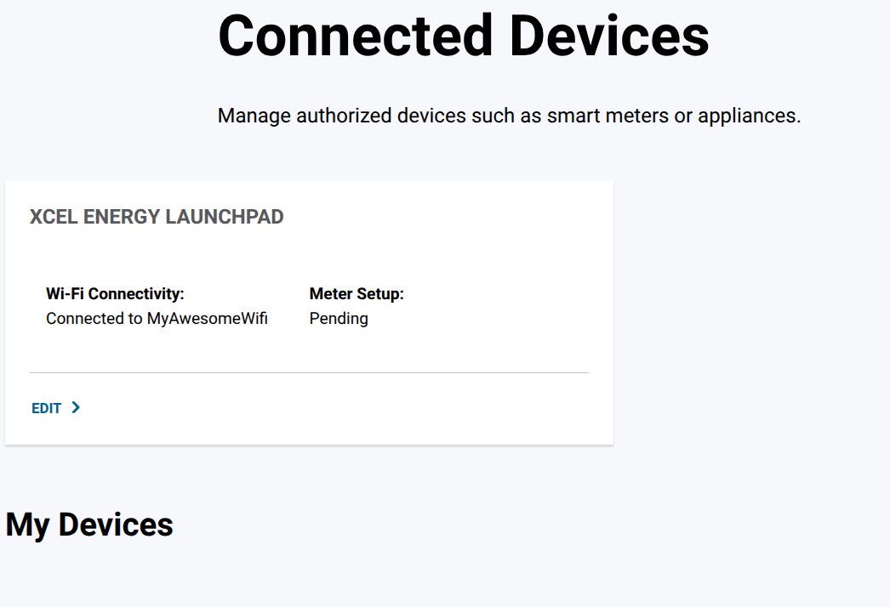

# Setting up an Xcel Energy meter

Xcel Energy's **Launchpad** service connects your smart meter to your home Wi-Fi so that devices you authorize can read
it locally. This guide walks through turning it on in Xcel's My Account and getting the meter into Home Assistant. Xcel
can change its pages at any time; if a step looks different, please
[open an issue](https://github.com/ismell/ha-ieee-2030-5/issues).

This integration is not affiliated with or endorsed by Xcel Energy.

## Before you start

- **An Xcel Energy smart meter.** The integration is tested with the Itron Gen5 Riva.
- **An Xcel Energy online account** (My Account) for the billing account the meter belongs to.
- **Your Wi-Fi name and password.** The meter connects on 2.4 GHz: both meters this was tested with joined the 2.4 GHz
  band. If your 2.4 GHz and 5 GHz networks have different names, use the 2.4 GHz one.
- **One meter per billing account.** Launchpad handles one meter per billing account. If your home has a second meter,
  for example a separate solar production meter, it needs a billing account of its own. Customers have done this by
  opening a second billing account under the same login and having the second meter moved to it.

## 1. Turn on Launchpad

1. Sign in to My Account, and open
   [Manage Billing Account](https://my.xcelenergy.com/MyAccount/s/profile/manage-billing-account) for the billing
   account of the meter.
2. Select the **Authorized Devices** tab, then **Edit Connected Devices**.

   

3. Accept the terms and conditions.

## 2. Connect the meter to your Wi-Fi

1. Open [Meters and devices](https://my.xcelenergy.com/MyAccount/s/meters-and-devices?wifistatus). The **Xcel Energy
   Launchpad** card shows **Pending**. Select **Manage**.

   

2. On **Connected Devices**, select **Edit**, and enter your Wi-Fi name and password.

   

3. Wait for **Wi-Fi Connectivity** to show **Connected**. Xcel asks you not to register a device (an LFDI) before it
   does.

The status on Xcel's page can lag behind: it showed **Not Connected** for a meter that had been on the Wi-Fi without a
break for twelve hours, until the page was refreshed. Refresh it, and use your router's list of connected devices as
the reliable check. The meter shows up there as an
Itron device. Note its IP address: you need it if Home Assistant does not discover the meter.

## 3. Wait for the meter setup

Once the meter is on your Wi-Fi, the page looks like this:

**Meter Setup** shows **Pending** until Xcel finishes setting the meter up, which can take days; customers have reported
weeks. Until then the meter
can already be on your Wi-Fi but refuses connections, so Home Assistant cannot set it up yet ("Failed to connect").

## 4. Add the meter to Home Assistant

1. Make sure Home Assistant can reach the meter on TCP port 8081, and that nothing else is reading it: see
   [Prerequisites](../README.md#prerequisites).
2. [Install the integration](../README.md#installation). The meter is usually discovered on its own; otherwise add the
   integration with the meter's IP address.
3. Choose **Generate a new certificate**. Home Assistant shows the certificate's **LFDI**, for example
   `431ED-86C1F-202CD-D3FEB-3EF8D-CB9F4-457F0-EC47D`.
4. Register that LFDI as a device on
   [Meters and devices](https://my.xcelenergy.com/MyAccount/s/meters-and-devices/manage-meters-and-devices). Xcel
   accepts it in groups of five, as shown, or without the dashes.
5. Registration can take a few days. Meanwhile a repair issue shows the LFDI, and Home Assistant keeps checking. Once
   the meter accepts the certificate, the sensors appear.

If you already registered a certificate for another tool, choose **Import a registered certificate** instead and paste
the certificate and its private key. Stop the other tool first: the meter serves one client at a time.

Then set up the [energy dashboard](../README.md#energy-dashboard).

## Keeping it working

- **Renew the certificate every three years.** Home Assistant raises a repair issue 60 days before it expires and
  keeps using the old certificate until Xcel has registered the new one. See
  [Renewing the certificate](../README.md#renewing-the-certificate).
- **If the meter goes silent for hours** while it still shows on your Wi-Fi, reconnecting it to the Wi-Fi brings it
  back. See [Recover the meter when its network freezes](../README.md#recover-the-meter-when-its-network-freezes-unifi).
- **If you change your Wi-Fi name or password,** update it with **Edit** on the Connected Devices page.

## A second meter

Each meter is its own entry in Home Assistant, with its own certificate registered on its own billing account's
Meters and devices page. A solar production meter has not been tested with the integration yet; this section will
cover it once it has.
